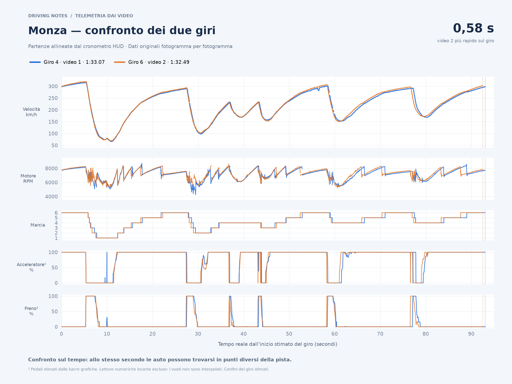

# Confronto dei due giri a Monza

Grafico ricavato dai due video onboard forniti dall'utente: velocità, RPM, marcia, acceleratore e freno.

- Blu: giro 4 del primo video, tempo mostrato nell'HUD 1:33.07.
- Arancione: giro 6 del secondo video, tempo mostrato nell'HUD 1:32.49.
- Differenza dei tempi mostrati: 0,58 secondi.

Le partenze sono allineate usando un riferimento stimato dal cronometro HUD. L'asse orizzontale mantiene il tempo reale di ciascun giro: allo stesso secondo le auto possono trovarsi in punti diversi della pista. Non è ancora un allineamento per distanza.

Acceleratore e freno sono percentuali stimate dalla lunghezza delle barre grafiche. Le letture numeriche incerte sono escluse dai grafici; i valori mancanti non sono interpolati. Si tratta di una prima estrazione automatica con verifiche a campione, da rivedere prima di un confronto definitivo.
