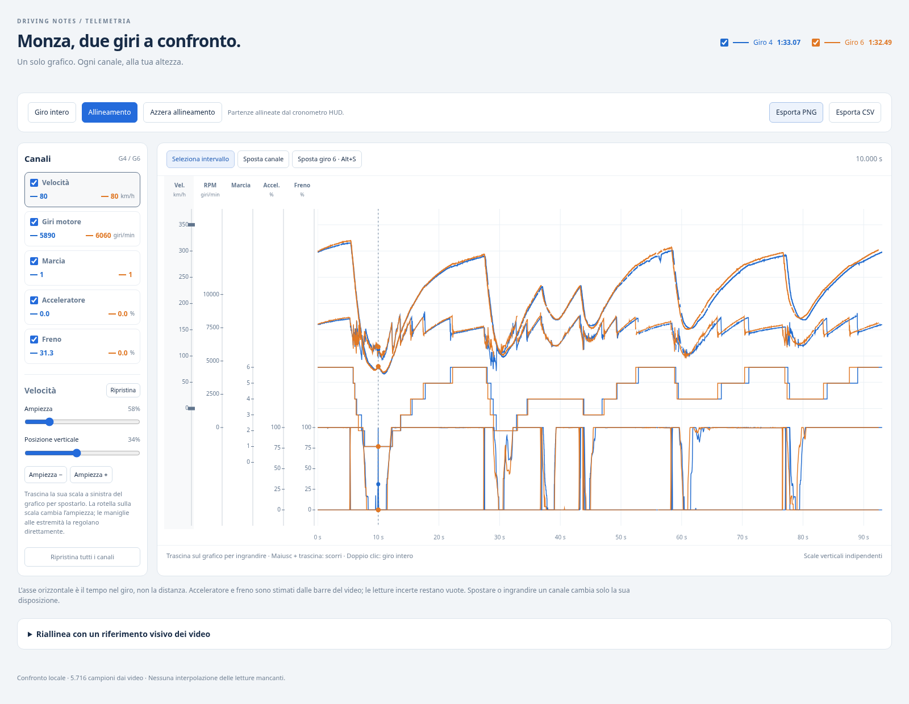

# Monza · confronto telemetria

**[Scarica il pacchetto interattivo](confronto-interattivo.zip)** · **[Guarda l'anteprima](confronto-interattivo-preview.png)** · [Grafico PNG](confronto-monza.png)

Scarica lo ZIP con il pulsante di download di GitHub, estrailo sul Mac e apri `confronto-interattivo.html` con Safari o Chrome. Non servono installazioni né connessione. È disponibile anche il [singolo file HTML](confronto-interattivo.html), da scaricare: GitHub non esegue la pagina nella propria anteprima.

## Un solo grafico, cinque canali

Velocità, giri motore, marcia, acceleratore e freno condividono lo stesso grafico e lo stesso asse del tempo. **Tutti i canali del giro 4 sono blu, tutti quelli del giro 6 arancioni, con linee continue.** Il cursore mostra i valori originali dei due giri nella lista dei canali.

La pagina consegnata non include canali o strumenti di sterzo.

### Disporre i canali

- **Sposta:** trascina verticalmente una delle scale colorate a sinistra del grafico. Puoi anche selezionare un canale e usare «Sposta canale» per trascinarlo direttamente nell'area del grafico.
- **Ingrandisci o rimpicciolisci:** usa la rotella sulla scala del canale, trascina le maniglie alle sue estremità oppure usa il cursore «Ampiezza». La rotella mantiene fermo il punto della scala sotto il puntatore.
- **Posizione verticale:** regolabile anche con il cursore nella barra laterale. I canali possono sovrapporsi e non sono vincolati a righe separate.
- **Visibilità:** le caselle permettono di nascondere un canale o uno dei giri, conservandone la disposizione.
- **Ripristina:** il pulsante del canale o il doppio clic sulla sua scala annullano i suoi spostamenti; «Ripristina tutti i canali» recupera la disposizione iniziale.
- La disposizione viene ricordata fra riaperture nel medesimo browser quando l'archiviazione locale è disponibile. Sul telefono viene mostrata una scala per volta, quella del canale selezionato.

Le scale verticali sono indipendenti: spostamento e ampiezza cambiano soltanto il disegno, non i valori o i tempi dei dati. Con il grafico a fuoco, Freccia su/giù sposta il canale selezionato e +/− ne cambia l'ampiezza.

### Tempo, allineamento ed esportazioni

- **Zoom sul tempo:** trascina sul grafico per selezionare e ingrandire un intervallo. Maiusc + trascinamento scorre nel tempo; doppio clic nell'area ripristina il giro intero.
- **Spostamento del dataset:** premi **Alt+S** (Opzione+S sul Mac), poi trascina orizzontalmente nell’area del grafico per spostare tutti i canali del giro 6 insieme. La vista temporale e i canali del giro 4 restano fermi durante il gesto. Alt+S o Esc torna alla selezione; è disponibile anche il pulsante «Sposta giro 6».
- **Allineamento visivo:** premi **Allineamento**, apri i due originali, fermali sullo stesso riferimento fisico (linea, cartello o passaggio) e premi «Allinea questi fotogrammi». «Torna al grafico» chiude il pannello. «Azzera allineamento» ripristina il riferimento iniziale. Entrambe le durate restano invariate.
- **PNG:** esporta il grafico unico con la disposizione, lo zoom, la visibilità e lo spostamento correnti.
- **CSV:** esporta sempre tutti i campioni dei cinque canali, anche se nascosti, con timestamp originali e tempo riallineato. Le letture mancanti restano vuote.

I video aperti dai selettori restano sul dispositivo; non sono inclusi nello ZIP.

## Dati e limiti

- Giro 4, primo video: tempo mostrato nell'HUD **1:33.07**.
- Giro 6, secondo video: tempo mostrato nell'HUD **1:32.49**.
- Differenza dei tempi mostrati: **0,58 s**.
- **5.716 campioni** originali, 2.952 + 2.764, a frequenza variabile.

I dati della precedente estrazione sono conservati. Le partenze sono stimate dal cronometro HUD. L'asse X è il tempo, non la distanza: allo stesso secondo le auto possono essere in punti diversi del circuito. Lo spostamento è unico per il giro, senza dilatazione o allineamenti locali multipli.

Acceleratore e freno sono percentuali stimate dalle barre grafiche, non misure della centralina. Le letture numeriche incerte restano escluse. Non vengono interpolati valori mancanti e i tratti con intervalli fra campioni superiori a 0,15 s non vengono collegati nel disegno. I dati restano una prima estrazione da video con controlli a campione.

[Sorgenti, rigenerazione e verifiche nel browser](viewer/README.md).
