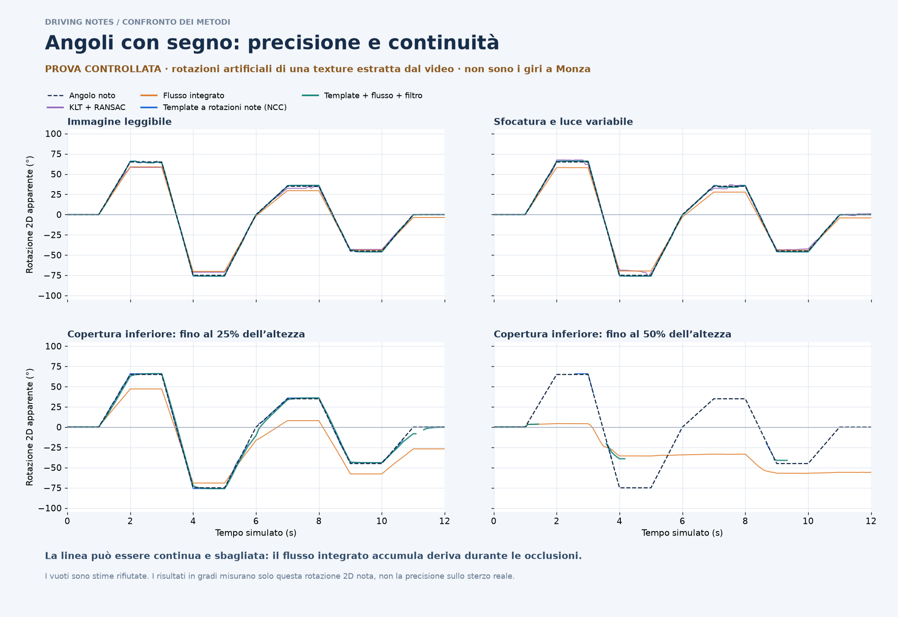

# Sterzo con segno: confronto dei metodi

**Convenzione richiesta per un futuro canale reale: destra positiva, sinistra negativa. L’indice 0–100 di attività già pubblicato non è uno sterzo e non va trasformato in gradi aggiungendogli semplicemente un segno.**

## Risultato pratico

Il riconoscimento diretto del riferimento evita la deriva del flusso integrato. Nei test controllati il template NCC è il più preciso con occlusione moderata; la fusione template/flusso restituisce più campioni, ma può aumentare l’errore mentre predice attraverso un tratto coperto. Sul piccolo campione reale, colore del pulsante e controllo del bordo scuro sono i candidati più promettenti; il solo template produce falsi agganci quando il pulsante scompare.

**Non è ancora possibile dichiarare quale metodo misuri meglio i gradi meccanici sui due giri:** manca una telemetria sterzo di riferimento e il volante è spesso coperto. I due confronti sotto misurano quantità diverse e non vanno confusi.



## 1. Prova con angoli noti — gradi apparenti 2D

Sono usati 145 istanti per scenario, quattro scenari e quattro metodi: 580 immagini di prova, 2.320 stime richieste. Una texture reale della zona volante viene ruotata artificialmente fra −75° e +65°. Sono aggiunti movimento comune della camera, sfocatura, variazioni di luce e occlusioni. Tutti i metodi ricevono le stesse immagini e la stessa stabilizzazione della scocca. Segno positivo: rotazione oraria della texture nell’immagine simulata. Questo **non calibra automaticamente destra/sinistra del volante reale**.

Le percentuali dei due scenari di copertura indicano l’altezza massima della fascia inferiore coprente rispetto al diametro del disco simulato, non la percentuale esatta di area occultata; la fascia varia nel tempo. Gli scenari sono 2D: non riproducono completamente la prospettiva, la deformazione dei guanti e le occlusioni dei filmati. Le soglie sono fisse per i quattro scenari. Gli errori sono calcolati soltanto quando il metodo restituisce un valore; la copertura e gli errori di segno sono riportati accanto. Un metodo che non restituisce valori durante la sterzata non è preciso solo perché riconosce i fotogrammi iniziali a zero.

| Scenario | Metodo | Errore medio ° | P95 ° | Copertura | Segni errati / pose attive restituite |
|---|---|---:|---:|---:|---:|
| Immagine leggibile | KLT + RANSAC | 1.77 | 6.72 | 100.0% | 0/106 |
| Immagine leggibile | Flusso integrato | 3.02 | 6.07 | 100.0% | 0/106 |
| Immagine leggibile | Template a rotazioni note (NCC) | 0.58 | 1.00 | 100.0% | 0/106 |
| Immagine leggibile | Template + flusso + filtro | 0.48 | 1.00 | 100.0% | 0/106 |
| Sfocatura e luce variabile | KLT + RANSAC | 1.50 | 5.13 | 100.0% | 0/106 |
| Sfocatura e luce variabile | Flusso integrato | 3.64 | 7.28 | 100.0% | 0/106 |
| Sfocatura e luce variabile | Template a rotazioni note (NCC) | 0.58 | 1.00 | 100.0% | 0/106 |
| Sfocatura e luce variabile | Template + flusso + filtro | 0.55 | 1.02 | 100.0% | 0/106 |
| Copertura inferiore: fino al 25% dell’altezza | KLT + RANSAC | non rappresentativo | — | 12.4% | 0/2 |
| Copertura inferiore: fino al 25% dell’altezza | Flusso integrato | 14.47 | 27.05 | 100.0% | 7/106 |
| Copertura inferiore: fino al 25% dell’altezza | Template a rotazioni note (NCC) | 0.69 | 1.25 | 93.1% | 0/104 |
| Copertura inferiore: fino al 25% dell’altezza | Template + flusso + filtro | 1.85 | 5.46 | 98.6% | 0/106 |
| Copertura inferiore: fino al 50% dell’altezza | KLT + RANSAC | non rappresentativo | — | 9.0% | 0/0 |
| Copertura inferiore: fino al 50% dell’altezza | Flusso integrato | 36.67 | 68.45 | 100.0% | 27/106 |
| Copertura inferiore: fino al 50% dell’altezza | Template a rotazioni note (NCC) | 0.59 | 1.87 | 20.0% | 0/16 |
| Copertura inferiore: fino al 50% dell’altezza | Template + flusso + filtro | 7.91 | 35.91 | 22.1% | 0/18 |

Il flusso integrato rimane continuo anche quando deriva: con occlusione moderata l’errore medio è circa 14,5°, con occlusione estesa circa 36,7°. Rendere più liscia la curva non corregge questo errore. Con occlusione estesa anche il template restituisce solo il 20% dei campioni: il basso errore dei pochi campioni visibili non dimostra copertura del giro.

## 2. Prova sui fotogrammi reali — pixel, non gradi

È stato scelto un riferimento realmente solidale al volante: il pulsante azzurro, distinguendolo dal casco e dal logo sul guanto. Il campione riguarda un breve tratto della prima chicane: 14 fotogrammi dai due video, uno usato come calibrazione condivisa e escluso dai punteggi; restano **5 fotogrammi con riferimento visibile e 8 con riferimento non visibile nel ritaglio**. È un test preliminare selezionato per visibilità/occlusione, non un campione casuale rappresentativo di tutto il giro.

Il ritaglio analizzato è di 360×170 pixel (coordinate originali x=1100…1460, y=1020…1190). «Non visibile» include sia copertura sia uscita dal ritaglio: non è una misura della visibilità del volante nell’intero video. Le coordinate sono letture visive approssimative dei ritagli, con incertezza di circa ±3 pixel e fino a ±5 nei campioni scuri. Gli scarti inferiori a questa incertezza non permettono di distinguere statisticamente due metodi. Il KLT qui è un riaggancio diretto al riferimento condiviso; non è il benchmark sequenziale KLT/RANSAC della prova controllata.

| Metodo | Scarto mediano dalle annotazioni (px) | Visibili restituiti | Falsi agganci quando non visibile |
|---|---:|---:|---:|
| Accordo colore + template | ≈1.3 | 5/5 | 0/8 |
| Colore + circolarità + bordo scuro | ≈1.2 | 5/5 | 0/8 |
| KLT diretto dal riferimento | non valutabile | 0/5 | 0/8 |
| Solo template del pulsante | ≈1.4 | 5/5 | 6/8 |
| SIFT + trasformazione affine | non valutabile | 0/5 | 0/8 |

Nel campione, colore e accordo colore/template sono sostanzialmente equivalenti entro l’incertezza delle annotazioni. Il solo template riconosce bene il punto quando visibile, ma accetta sei falsi agganci su otto casi non visibili: non è affidabile da solo. KLT e SIFT non restituiscono stime accettate sulle pose di valutazione: non se ne può calcolare un errore affidabile.

Una prova aggiuntiva, riproducibile con `real_marker_methods.py --jpeg-quality 98`, di ricompressione JPEG a qualità 98 fa perdere un campione visibile ai due metodi che usano il colore (4/5 invece di 5/5). Questo segnala sensibilità alle soglie e conferma che serve una verifica più ampia prima di parlare di robustezza.

[Ritagli e confronto del punto annotato](real_marker_review.jpg) · [Annotazioni](real_marker_annotations.json) · [Risultati reali](real_marker_predictions.csv) · [Risultati controllati](controlled_predictions.csv)

## Come rendere più precisa la prossima versione

1. **Seguire riferimenti rigidi del volante**, per esempio due pulsanti riconoscibili; usare la scocca solo per la camera e lo zero. Le mani possono muoversi sul volante e generare un segno errato.
2. **Ritrovare il riferimento a ogni fotogramma e seguire una zona di ricerca mobile**, verificando insieme colore, forma e geometria. Il flusso ottico deve collegare gli agganci, non determinare da solo l’angolo per tutto il giro.
3. **Calibrare la prospettiva e il segno.** Una linea della scocca non basta a convertire qualsiasi movimento 2D in gradi meccanici: servono un asse/centro e una geometria coerente del volante. Il verso va verificato su una manovra nota.
4. **Filtrare dopo aver rifiutato i falsi agganci.** Un filtro temporale può ridurre rumore e salti, ma deve dichiarare quando sta predicendo. Nei test la fusione copre più fotogrammi, non è sempre la più accurata.
5. **Limitare i tratti ricostruiti.** Da testare come limite prudente circa 0,15–0,2 s per colmare un buco corto; non è una prestazione già verificata qui. Quando il riferimento rimane nascosto, lasciare un buco invece di inventare una curva continua.

Queste prove non sostituiscono una misura reale dello sterzo. Non è stata caricata una nuova curva in gradi sui due giri come se fosse validata.

## Riproduzione

Con Python, NumPy, OpenCV e Matplotlib, dalla radice del repository:

```bash
OPENBLAS_NUM_THREADS=1 python telemetry/monza/steering/benchmark/controlled_methods.py
python telemetry/monza/steering/benchmark/real_marker_methods.py
python telemetry/monza/steering/benchmark/real_marker_methods.py --jpeg-quality 98
python telemetry/monza/steering/benchmark/make_report.py
```

Gli input sono inclusi: texture di riferimento e ritagli dei fotogrammi. Le annotazioni sono visive e il fotogramma di calibrazione non è valutato. Gli script producono CSV e JSON con i risultati; non modificano i dati di telemetria dei due giri.
