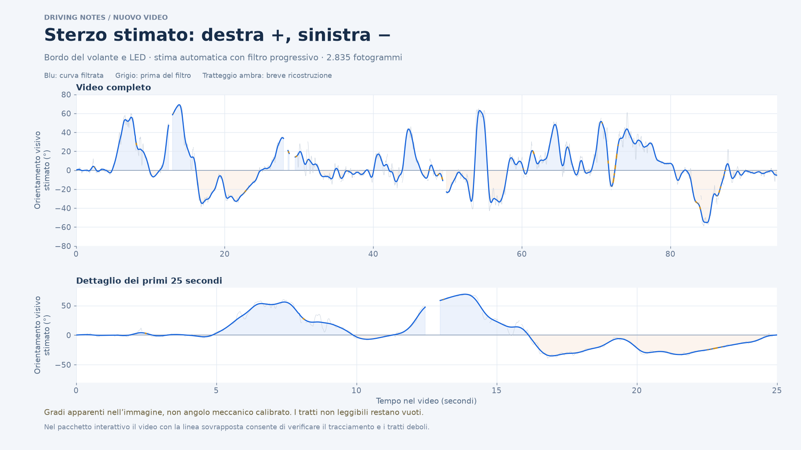

# Sterzo stimato dal nuovo video

**[Guarda il grafico](sterzo-stimato.png)** · **[Scarica la versione interattiva](sterzo-interattivo.zip)** · [Video con linea sovrapposta](verifica-sterzo.mp4) · [Dati CSV](steering.csv)

Scarica lo ZIP con il pulsante di download di GitHub, aprilo sul Mac e apri `sterzo-interattivo.html` con Safari o Chrome. Il grafico e il video sono già inclusi: non occorre scegliere punti, tracciare linee o installare software.



## Cosa rappresenta

È una curva ricavata automaticamente dal filmato `ScreenRecording_10-08-2026 14-15-49_1.mov`, circa 94,35 secondi. **Destra positiva, sinistra negativa**: il verso è stato controllato sulla prima curva a destra e su una curva a sinistra del filmato. L'asse orizzontale è il tempo del video; non è stato ricavato o dichiarato il tempo sul giro.

La grandezza è l'**orientamento apparente del bordo superiore del volante nell'immagine**, in gradi visivi. Non è una misura calibrata dell'angolo meccanico del piantone o delle ruote. La prospettiva può cambiare la scala; i numeri non vanno confrontati direttamente con un sensore reale di sterzo.

## Come viene ricavata

- Il bordo superiore e la fila di LED forniscono orientamenti visivi assoluti del volante, evitando di sommare per tutto il filmato il movimento dei guanti.
- La zona di analisi e il riferimento iniziale sono specifici di questa telecamera. Lo zero viene stimato nel tratto iniziale diritto fra 1 e 4 secondi, con la scocca come riferimento fisso nel video della camera solidale alla macchina. Non è stata applicata una calibrazione 3D della prospettiva.
- Fra più segmenti candidati viene scelta globalmente la sequenza coerente, penalizzando cambiamenti bruschi non sostenuti dai fotogrammi.
- Un filtro robusto offline riduce oscillazioni e salti. Il grafico conserva la selezione prima del filtro, visibile come linea grigia, per controllare l'effetto del filtraggio.
- I buchi brevi fino a 0,4 s possono essere ricostruiti e sono segnalati con tratteggio ambra e stato `short_gap_reconstructed`. I buchi più lunghi rimangono vuoti. Non sono stati disegnati manualmente profili delle curve.

Il filtro migliora la regolarità della traccia, non certifica la correttezza di ogni aggancio. Con rotazioni ampie e occlusioni sono ancora possibili agganci a guanti o bordi diversi: il video di verifica mostra la linea rilevata e segnala il supporto debole.

## Dati e verifiche

- 2.835 fotogrammi originali analizzati; tutti i timestamp confrontati con ffprobe, senza discrepanze.
- 2.766 campioni con una stima, dei quali 181 ricostruiti su buchi brevi; 69 campioni non leggibili restano vuoti.
- Sette controlli visivi su segmenti leggibili del bordo: scarto massimo circa 6,1° apparenti rispetto ad annotazioni approssimative con incertezza di circa ±5°. È un controllo a campione su orientamenti 2D, non una validazione dell'intero video o dei gradi meccanici.
- Verificati nel browser: caricamento dei dati e del video, segno del valore durante la riproduzione, cursore, zoom, esportazione PNG/CSV e layout mobile.

`visual_support` è una valutazione euristica della geometria disponibile, non una probabilità di correttezza. La linea verde nel video indica supporto maggiore, l'ambra supporto debole; la linea grigia è il riferimento fisso. La linea sovrapposta mostra il rilevamento, mentre il numero e il grafico usano la stima filtrata. L'anteprima video è ricampionata a 15 fps; il CSV conserva i fotogrammi e i timestamp originali.

## Comandi della pagina

- **Zoom:** trascina sul grafico, usa la rotella oppure i pulsanti.
- **Verifica:** un clic sul grafico porta il video a quel punto; durante la riproduzione il cursore segue il video.
- **Esporta:** salva una PNG della vista attuale o il CSV completo.
- **Confronto del filtro:** mostra la selezione prima del filtro con la casella dedicata.

## Campi CSV

- `frame_index`, `video_time_s`: fotogramma e tempo originali.
- `steering_apparent_deg`: orientamento visivo stimato, con segno; vuoto se non leggibile.
- `selected_angle_raw_deg`: selezione geometrica prima del filtro; non è un valore del sensore.
- `raw_edge_angle_deg`, `raw_led_angle_deg`: candidati visivi prima di associazione, zero e filtro; possono essere errati.
- `status`: `visual_orientation_estimate`, `short_gap_reconstructed` oppure `unreadable`.
- `support_strength`, `visual_support`: evidenza geometrica euristica disponibile.

[Metadati e hash del file sorgente](metadata.json) · [Annotazioni dei controlli visivi](visual-checks.json)

## Riprodurre l'analisi

Con Python, NumPy, OpenCV, SciPy e Matplotlib, dalla radice del repository:

```bash
python telemetry/steering-new-video/tools/extract_orientation.py '/percorso/al/video.mov' --out /tmp/steering-new
python telemetry/steering-new-video/tools/filter_orientation.py --out /tmp/steering-new
python telemetry/steering-new-video/tools/make_overlay.py --out /tmp/steering-new
```

Questi comandi generano l'analisi e le annotazioni ASS nella cartella di lavoro scelta. La geometria è specifica del video originale a 2622×1206: non è ancora un estrattore universale per altre telecamere. Per la sovrapposizione si usa FFmpeg con ritaglio `530:186:1000:1020`, scala `848:298` e sottotitoli ASS. Il video originale non è incluso nel repository.

Per rigenerare la pagina dagli artefatti già inclusi:

```bash
python telemetry/steering-new-video/tools/build_viewer.py
```

Il test `tools/browser_check.py` richiede Playwright e Chromium. I limiti e le stime incerte rimangono visibili anche nell'esportazione.
