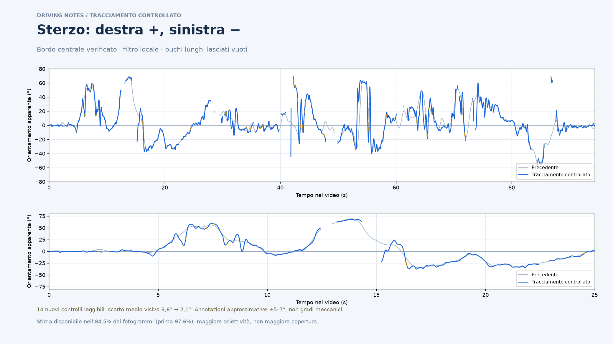

# Sterzo: tracciamento controllato

**[Scarica lo ZIP interattivo](sterzo-interattivo.zip)** · **[Guarda il confronto](sterzo-stimato.png)** · [Video di verifica](verifica-sterzo.mp4) · [CSV](steering.csv) · [Versione precedente](../README.md)

Scarica lo ZIP, estrailo sul Mac e apri `sterzo-interattivo.html` con Safari o Chrome. Video, grafico, zoom ed esportazioni sono già inclusi. Non occorre selezionare punti o calibrare manualmente.



## Cosa cambia

Il rilevamento verifica il profilo luminoso del bordo grigio e favorisce il tratto centrale, penalizzando segmenti laterali che potrebbero appartenere alle estremità curve. I LED corroborano un bordo solo se anche la loro posizione relativa è compatibile. Un controllo locale rifiuta salti isolati prima del filtro. Il filtro lavora su ciascun tratto leggibile separatamente: un aggancio oltre un lungo buco non modifica il tratto precedente. I buchi fra osservazioni distanti al massimo 0,25 secondi possono essere ricostruiti e sono segnati in ambra.

La misura resta **l'orientamento apparente 2D**, con destra positiva e sinistra negativa. Non è l'angolo meccanico del piantone. La geometria è specifica di questo video; zero automatico nel tratto 1–4 secondi, camera considerata solidale alla scocca. Non è stata applicata una calibrazione prospettica o una correzione del movimento della camera.

## Controlli e compromesso

Sono stati esaminati 48 fotogrammi distribuiti nel video: 32 durante lo sviluppo e altri 16 per il controllo finale. Nei 16 finali, 14 mostrano un segmento del bordo leggibile; 2 sono ambigui e non hanno un angolo di riferimento. I riferimenti finali sono stati annotati prima di confrontarli con il nuovo metodo; il metodo non è stato ritoccato dopo questo confronto.

| Confronto sui medesimi fotogrammi leggibili | Precedente | Controllato |
| --- | ---: | ---: |
| Scarto medio, 14 controlli finali | 3,58° | 2,09° |
| Scarto massimo, 14 controlli finali | 7,97° | 4,56° |
| Scarto medio, 20 controlli di sviluppo comuni | 6,37° | 2,58° |
| Stime disponibili nell'intero video | 2.766 / 2.835 (97,6%) | 2.396 / 2.835 (84,5%) |
| Di cui ricostruite su buchi brevi | 181 | 351 |
| Campioni lasciati vuoti | 69 | 439 |

**Le annotazioni sono stime visive approssimative, con incertezza tipicamente ±5° e in alcuni casi ±7°.** Il risultato suggerisce migliore accordo su questi campioni; non certifica un'accuratezza di 2° sull'intero video o sullo sterzo meccanico. La riduzione dello scarto va letta insieme alla minore copertura: il nuovo metodo restituisce meno valori. Anche con questi controlli restano possibili agganci errati quando il bordo è coperto o confuso con guanti e altri elementi.

Le curve del grafico di confronto sono entrambe conservate. Il pacchetto interattivo mostra la nuova stima; il pacchetto precedente rimane disponibile nella cartella superiore.

## Verifica visiva e dati

Il video sovrappone **il segmento effettivamente selezionato**, verde per supporto maggiore e ambra per supporto debole. Il numero è filtrato; la linea è il rilevamento prima del filtro. Nei tratti ricostruiti non viene disegnata una linea rilevata. La linea grigia è un riferimento fisso nell'immagine. Il video di verifica è a 15 fps; JSON e CSV conservano i 2.835 fotogrammi e timestamp originali.

- `steering_apparent_deg`: curva filtrata, vuota dove non leggibile.
- `selected_angle_raw_deg`: angolo selezionato prima del filtro, dopo lo zero; assente per campioni scartati o ricostruiti.
- `selected_segment`: estremi del segmento osservato nelle coordinate del video originale; assente per campioni scartati o ricostruiti.
- `status`: `visual_orientation_estimate`, `short_gap_reconstructed`, `unreadable`.
- `support_strength` e `visual_support`: indicatori euristici, non probabilità di correttezza.
- `temporal_outlier_rejected`: campione escluso dal controllo locale. In questo video sono 36.

[Riferimenti e risultati dei controlli](audit/) · [Metadati e hash del video](metadata.json)

## Riprodurre

Dipendenze Python: NumPy, OpenCV, SciPy e Matplotlib; FFmpeg con libass per il video. Il video sorgente originale non è incluso nel repository. Dalla radice del repository:

```bash
python telemetry/steering-new-video/refined/tools/track.py '/percorso/al/video.mov' --out telemetry/steering-new-video/refined
python telemetry/steering-new-video/refined/tools/overlay.py
ffmpeg -y -i '/percorso/al/video.mov' -vf 'crop=530:186:1000:1020,scale=848:298,fps=15,ass=telemetry/steering-new-video/refined/overlay.ass' -an -c:v libx264 -preset fast -crf 24 -pix_fmt yuv420p -movflags +faststart telemetry/steering-new-video/refined/verifica-sterzo.mp4
python telemetry/steering-new-video/refined/tools/audit.py
python telemetry/steering-new-video/refined/tools/build_viewer.py
```

Il test `tools/browser_check.py` richiede Playwright e Chromium. Sono stati verificati: corrispondenza di tutti i timestamp con ffprobe, segni destra/sinistra, stati e buchi nel CSV, limite dei tratti ricostruiti, sincronizzazione video, zoom e trascinamento, esportazioni PNG/CSV e layout mobile.
