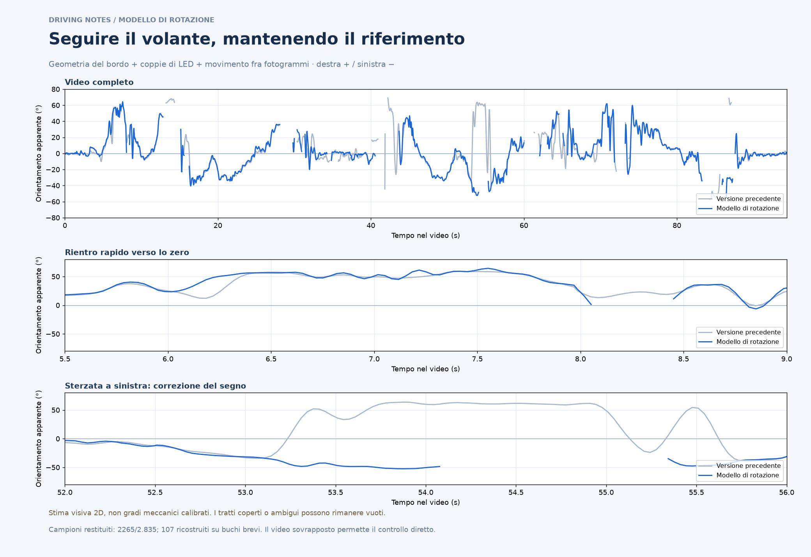

# Sterzo: modello di rotazione

**[Scarica il pacchetto interattivo](sterzo-interattivo.zip)** · **[Guarda il confronto](sterzo-stimato.png)** · **[Video con sovrapposizione](verifica-sterzo.mp4)** · [CSV](steering.csv)

Scarica lo ZIP, estrailo sul Mac e apri `sterzo-interattivo.html` con Safari o Chrome. Il video e i dati sono già inclusi. La curva grigia mostra la versione precedente; la blu usa il modello di rotazione. Non occorre selezionare punti.



## Problema affrontato

La precedente selezione dei segmenti poteva seguire parti dei guanti o bordi diversi: il filtro produceva quindi una curva liscia ma sbagliata. Un caso evidente è il tratto intorno a 54 s, dove compariva una sterzata positiva mentre il bordo visibile era inclinato a sinistra. Il filtro rallentava anche alcuni rientri rapidi verso lo zero, per esempio intorno a 8 s.

Il nuovo metodo usa la geometria dell'intero movimento del bordo. I suoi numeri restano **orientamenti apparenti nell'immagine**, con destra positiva e sinistra negativa; non sono una misura calibrata dell'angolo meccanico del piantone.

## Metodo

1. Da 772 osservazioni lunghe e leggibili del bordo viene stimato automaticamente un centro di rotazione apparente e la distanza orientata del bordo dal centro. Il centro è sotto il limite inferiore dell'immagine. Il residuo mediano del fit è circa 0,83 pixel: descrive l'accordo di quelle rette con il modello, non l'accuratezza in gradi del video intero.
2. Per ogni fotogramma si cercano profili luminosi del bordo nelle posizioni previste da diverse rotazioni di quel modello. Si controllano anche contrasto, colore e quantità di supporto visibile. Questo vincolo distingue molte linee dei guanti da quelle del volante.
3. Coppie di gruppi di LED forniscono un riferimento aggiuntivo quando posizione, distanza e inclinazione sono compatibili con la zona del volante. Il supporto dei LED è indicato come indiretto nella sovrapposizione.
4. Una selezione temporale combina evidenza visiva e movimento angolare fra fotogrammi, con controlli del flusso ottico avanti/indietro. I rilevamenti più chiari possono imporre manovre rapide; quando l'immagine è ambigua viene penalizzato un cambio improvviso del riferimento. La velocità è uno stato approssimato dell'associazione, non una misura del sensore.
5. Il filtro finale è locale e leggero. Lo zero resta stimato automaticamente nel tratto iniziale 1–4 s. I buchi fra osservazioni distanti al massimo 0,3 s possono essere ricostruiti e sono segnati in ambra; gli altri restano vuoti.

Il modello è specifico della geometria di questo video a 2622×1206, con camera considerata solidale alla scocca. Non applica una calibrazione prospettica 3D. Con occlusioni e grandi rotazioni sono ancora possibili agganci errati, deviazioni o campioni assenti.

## Cosa è migliorato e cosa rimane aperto

Il rientro visibile intorno a 8,05 s viene mantenuto vicino allo zero e il tratto leggibile intorno a 54 s restituisce valori negativi. Questi comportamenti sono verificati sia nei dati sia nel video.

Sono stati riesaminati anche 28 nuovi fotogrammi di transizioni difficili, 16 dei quali consentono un riferimento approssimativo del bordo. Su questi la versione precedente restituisce 11 valori e la nuova 10; per un confronto equo, lo scarto qui sotto usa soltanto i 9 fotogrammi restituiti da entrambe. Le altre serie riportano i controlli già esistenti.

| Confronto sui medesimi fotogrammi | Precedente | Modello di rotazione |
| --- | ---: | ---: |
| Scarto medio su 9 transizioni difficili comuni | 24,08° | 5,87° |
| Segni errati sulle 7 pose attive di quel confronto | 2 | 0 |
| Scarto medio su 19 controlli di sviluppo comuni | 2,59° | 2,60° |
| Scarto medio sui 14 controlli precedenti | 2,09° | 2,33° |
| Valori restituiti nel video | 2.396 / 2.835 (84,5%) | 2.265 / 2.835 (79,9%) |
| Di cui ricostruiti su buchi brevi | 351 | 107 |
| Valori lasciati vuoti | 439 | 570 |

**Il miglioramento riguarda errori importanti in alcuni passaggi; non è uniforme su tutto il video.** Le annotazioni sono letture visive approssimative con incertezza ±5–7°, senza telemetria sterzo reale. I nuovi controlli sono stati usati per lo sviluppo e la diagnosi: non sono un test indipendente con cui certificare un'accuratezza generale. Tutti i riferimenti, risultati e denominatori sono disponibili in [audit](audit/).

## Sovrapposizione e CSV

La linea colorata del video rappresenta **la posa del bordo ricostruita dal modello geometrico**, non una coppia di estremi misurati direttamente. Verde: supporto diretto maggiore dal bordo. Ambra: supporto debole o indiretto dai LED. Il testo segnala l'uso dei LED; nei tratti ricostruiti non viene disegnata una linea osservata. Il riferimento grigio è fisso nell'immagine. Il video di verifica è a 15 fps; CSV e JSON mantengono tutti i 2.835 timestamp originali.

Il canale da usare è `steering_apparent_deg`, vuoto quando `status` è `unreadable`. `selected_angle_raw_deg` mostra la selezione prima del filtro; `selected_segment` contiene la posa modellata nelle coordinate del video. `model_angle_deg` è un candidato interno non azzerato, anche nei tratti non leggibili: non va usato come telemetria. `rim_support`, `led_support`, `support_strength` e `visual_support` sono indicatori euristici, non probabilità di correttezza. `reference_source` distingue supporto dal modello del bordo o dalla fila di LED.

## Riproduzione

Con Python, NumPy, OpenCV, SciPy, Matplotlib e FFmpeg con libass, dalla radice del repository:

```bash
python telemetry/steering-new-video/rigid/tools/calibrate.py '/percorso/al/video.mov'
python telemetry/steering-new-video/rigid/tools/extract.py '/percorso/al/video.mov'
python telemetry/steering-new-video/rigid/tools/filter.py
python telemetry/steering-new-video/rigid/tools/report.py
python telemetry/steering-new-video/rigid/tools/overlay.py
ffmpeg -y -i '/percorso/al/video.mov' -vf 'crop=530:186:1000:1020,scale=848:298,fps=15,ass=telemetry/steering-new-video/rigid/overlay.ass' -an -c:v libx264 -preset fast -crf 24 -pix_fmt yuv420p -movflags +faststart telemetry/steering-new-video/rigid/verifica-sterzo.mp4
python telemetry/steering-new-video/rigid/tools/build_viewer.py
```

Il video originale non è incluso. L'estrazione crea una cache locale `evidence.npz`, esclusa da Git. Il fit e l'estrazione sono stati rieseguiti sul video completo. Le evidenze estratte sono riprodotte entro 0,0001 e tutti i timestamp coincidono con quelli originali.

Sono verificati: timestamp originali, CSV, segni delle manovre riconoscibili, rientro rapido, buchi e limite di ricostruzione. `tools/browser_check.py` richiede Playwright e Chromium e verifica video sincronizzato, confronto con la curva precedente, zoom, trascinamento, esportazioni PNG/CSV e layout mobile.

[Calibrazione apparente del modello](model-calibration.json) · [Metadati](metadata.json) · [Versione precedente](../refined/README.md)
